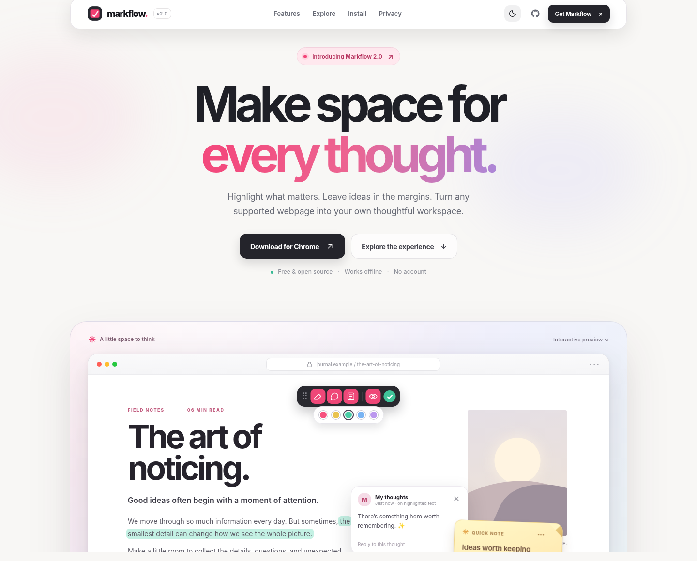
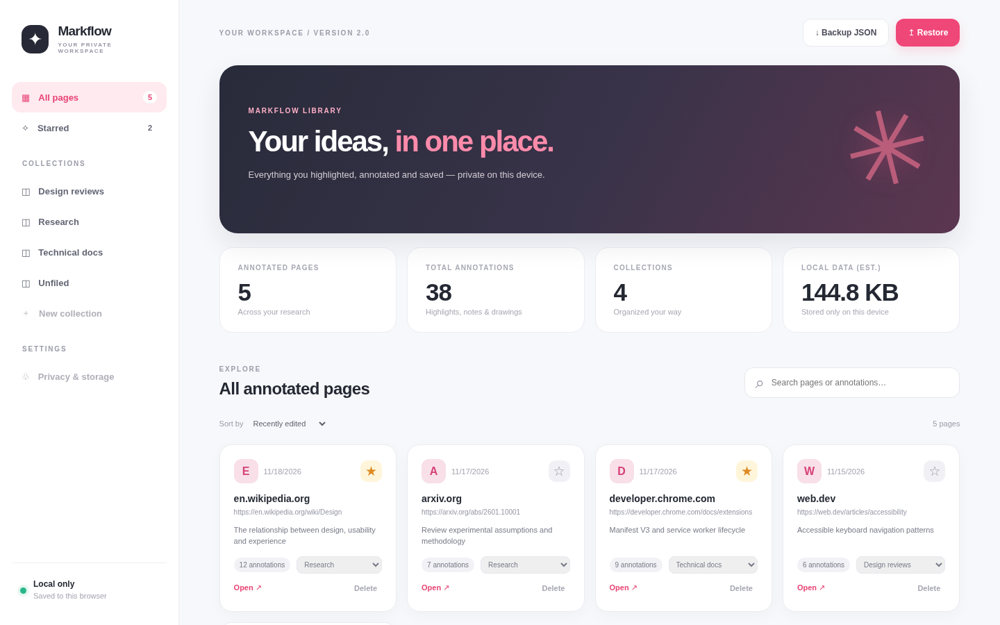

# ✦ Markflow 2.0 — Local-first Web Annotation Workspace

[](https://kami80.github.io/highlighter/)

**[Explore the interactive project website](https://kami80.github.io/highlighter/)** · [Download an installable Chrome extension](https://github.com/kami80/highlighter/releases/latest) · [Source & issues](https://github.com/kami80/highlighter)

The GitHub Pages site has a responsive, Apple-inspired presentation, an **interactive sample annotation workspace**, live theme switch, screenshot gallery and GitHub installation guide. The sample on the website is a demonstration, **not a working extension or a place to store notes**. Actual annotations stay in the Chrome extension's IndexedDB. The website is fully static and has no CDN dependencies.


**GitHub repository:** [`kami80/highlighter`](https://github.com/kami80/highlighter) · **Project website:** [kami80.github.io/highlighter](https://kami80.github.io/highlighter/)

**Project name:** Markflow · **Repository name:** `highlighter`

**Free · MIT licensed · Manifest V3 · Fully local · No backend · No account · No HTML export**

Markflow brings highlights, threaded comments, image annotations, drawings, and richly formatted sticky notes directly onto public webpages. Everything is stored on **your device** in the extension's IndexedDB database.



## What's new in v2.0

- **Privacy Center:** Pause Markflow on any exact hostname in **Library → Privacy & storage → Excluded websites**. It will not read or display saved annotations there after refreshing that tab. To resume, remove the exclusion and refresh.
- **Safer multi-tab editing:** V2 uses revision-aware writes with three-way merging for independent changes. If two tabs edit the *same* annotation differently, Markflow warns rather than silently replacing either saved edit. Download an unsaved JSON copy or reload the saved version.
- **Starred research:** Mark important websites as favorites in the Library and filter to **Starred**.
- **Storage Health:** See the local database name, schema version, estimated annotation payload size, annotation types, pages, and exclusion count. Values are estimates, **not** an OS disk usage measurement.
- **Delete one page:** Remove all annotations for one saved website from its card, with confirmation. Create a backup first for anything important.
- **Improved keyboard focus:** High-visibility keyboard focus outlines, reduced-motion support, and more responsive Library cards.
- **Privacy footprint:** Opening an unannotated page no longer creates an empty IndexedDB record just from browsing.

All v1.6 features remain: smart selection, rounded/marker/underline highlights, comments and replies, drag/resize rich notes, self-healing text anchors, image comments, layer visibility, command palette, offline reading mode, and JSON backup/restore.

## Downloads and public GitHub release

> **Publishing note:** If your repository is not yet deployed, the following public links become active after you publish the release ZIP and enable GitHub Pages.

- **Source repository:** https://github.com/kami80/highlighter
- **Project website:** https://kami80.github.io/highlighter/
- **Latest releases:** https://github.com/kami80/highlighter/releases
- **Direct extension ZIP (after release):** https://github.com/kami80/highlighter/releases/latest/download/markflow-v2.0-extension-only.zip
- **Bug reports and feature requests:** https://github.com/kami80/highlighter/issues
- **Privacy policy (after Pages is enabled):** https://kami80.github.io/highlighter/privacy.html

- **End users:** Download `markflow-v2.0-extension-only.zip` from [**Releases → v2.0.0**](https://github.com/kami80/highlighter/releases/tag/v2.0.0). Extract and load the folder containing `manifest.json` through Chrome's **Load unpacked** feature.
- **Developers:** Clone/download this repository to inspect the source, run tests, or contribute.
- **Website:** `docs/` is the static GitHub Pages landing page at https://kami80.github.io/highlighter/. After enabling Pages and publishing the release ZIP, its Download button targets the latest release asset.
- **License:** [MIT](LICENSE) — free to use, modify, and redistribute under its terms.

No Chrome Web Store listing is included; installation through GitHub is manual.

## Install

1. Get `markflow-v2.0-extension-only.zip` from [kami80/highlighter Releases](https://github.com/kami80/highlighter/releases) and extract it.
2. Visit `chrome://extensions`, enable **Developer mode**, and click **Load unpacked**.
3. Select the unzipped folder containing `manifest.json`.
4. Open an `https://` or `http://` page and click the Markflow toolbar icon.
5. Use the **Library** button to manage saved webpages, backup/restore, or configure privacy.

Chrome prohibits content scripts on internal pages, many browser-managed PDFs, and the Chrome Web Store.

### Upgrade without losing notes

**Before upgrading, create a JSON backup in Markflow v1.6.** Then overwrite the files inside your **current unpacked extension folder**, preserving its directory path, and press **Reload** under `chrome://extensions`.

Do **not** uninstall the old extension first: a different extension ID has a separate IndexedDB database. Notes live in the browser profile, not inside this Git repository.

V2 uses the **same** `markflow-annotations` IndexedDB database and `pages` store as v1.5/v1.6; its schema remains version 2. Legacy `chrome.storage.local` v1.4 records are still migrated on demand. New fields are optional (`revision`, `favorite`) and do not rename annotation IDs or types.

## Using v2.0

**Privacy exclusions:** Library → Privacy & storage → type `example.com` → Add. Domain exclusions are exact: `example.com` does not also exclude `www.example.com`. Refresh existing webpage tabs to apply your changes. To access the library when a site is excluded, click the extension icon on that page.

**Multi-tab conflicts:** Distinct annotation edits merge safely. If two tabs change the same annotation, the last change **is not silently saved**; the latest conflicting tab shows a warning. Use **Save local JSON** to preserve its unsaved state, then reload the saved version and reapply the edit. JSON is for recovery; it is *not* an HTML page export.

**Favorites:** Click the ☆ star on any Library card. The Starred view lists favorite pages.

**Safe deletion:** Choose Delete on the Library card. You'll be asked to confirm. This action deletes the local copy for that webpage.

**Backup and restore:** Download JSON from the Library header or Privacy Center. Restore supports Merge and Replace. Backups can include private webpage snippets and notes; store them securely.

**Keyboard shortcuts:** `Ctrl/⌘+Shift+P` command palette · `Ctrl/⌘+Alt+Z` undo · add Shift for redo · `Alt+Shift+A` toolbar · `Alt+Shift+H` highlight · `Alt+Shift+C` comment · `Alt+Shift+N` note · `Alt+Shift+L` manager.

## Privacy and limitations

- Data is stored in Chrome's extension-origin IndexedDB and not intentionally uploaded to any server.
- The extension still requests access to ordinary HTTP/HTTPS websites to work there; pause controls prevent local annotation processing on selected hosts after reload. These controls do **not** revoke Chrome's installed extension permissions.
- No cloud synchronization, remote telemetry, paid services, background analytics, or HTML export.
- JSON backups are manual. Clearing browser extension storage or uninstalling may erase notes.
- Webpages can change, so text anchors may still need manual repair; dynamic sites and nested frames are not universally supported.
- In case of conflicting edits, use **Save local JSON** immediately. The file is a safety copy and isn't automatically re-imported into the active page.

## Testing

```bash
node --check background.js
node --check content.js
node --check library.js
node tests/test_background.cjs
node tests/test_background_v16.cjs
node tests/test_background_v20.cjs
python tests/test_v15.py
python tests/test_v16.py
python tests/test_v20.py
```

Browser UI tests use headless Chromium and simulated Chrome messaging. GitHub Actions can run both source/contract tests and browser UI checks. IndexedDB storage contract tests use a deterministic mock, not an actual installed extension. In this environment, a persistent Chromium extension context did not launch the extension service worker, so **real Chrome extension lifecycle and migration remain to be manually verified before a public store release**. See [TEST-RESULTS.md](TEST-RESULTS.md).

## GitHub & contributions

The redesigned, self-contained GitHub Pages website is in `docs/` and can be published at [kami80.github.io/highlighter](https://kami80.github.io/highlighter/) from `main` → `/docs`; GitHub Actions source checks run on pushes and pull requests. Read [GITHUB-PUBLISHING.md](GITHUB-PUBLISHING.md) for detailed GitHub upload, release, and Pages instructions. Contributions are welcome under [MIT](LICENSE); see [CONTRIBUTING.md](CONTRIBUTING.md) and [SECURITY.md](SECURITY.md).

## Release verification and packaging

Rebuild the installable ZIP using Python (no extra packaging dependencies):

```bash
python scripts/verify_release.py
python scripts/package_release.py
```

The resulting file is `dist/markflow-v2.0-extension-only.zip`. This is the ZIP to attach to a GitHub **Release**, while the entire repository contains the source code and website. The full step-by-step guide for [github.com/kami80/highlighter](https://github.com/kami80/highlighter) is [GITHUB-PUBLISHING.md](GITHUB-PUBLISHING.md).

For browser UI tests in a developer environment, install Playwright and its Chromium browser using the commands in `.github/workflows/checks.yml`. These browser tests simulate extension messaging, so they supplement rather than replace manual installed-extension testing.


## Redesigned website (GitHub Pages)

The public site lives at **https://kami80.github.io/highlighter/** and is deployed from `main` → `/docs`. Its files are `docs/index.html`, `docs/site.css`, `docs/site.js`, and `docs/assets/`; no build or npm install is required. The privacy page is at `docs/privacy.html`.

To update the website, push a commit to `main`. To publish the installable Chrome ZIP, create/publish a GitHub Release; `.github/workflows/release-asset.yml` will attach `markflow-v2.0-extension-only.zip` after validation. You can also manually upload the ZIP from `dist/`. See [PUBLISHING-V2.md](PUBLISHING-V2.md) for exact commands and screenshots of the workflow.
